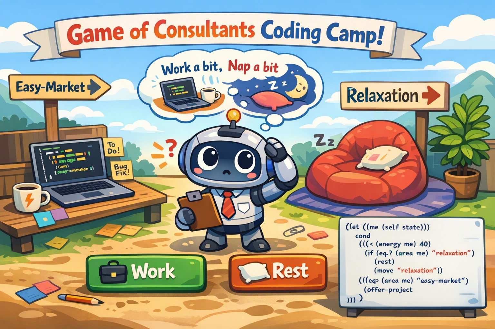

# Welcome to the Game of Consults Code Camp

## Game of Consults: strategy meets code

We welcome you to implement a bot that makes decisions in a lively consulting marketplace. Write its strategy, test it, and submit it to the game. Will it sharpen its skills, recharge at just the right moment, or jump on a promising project? **Every decision can change the outcome.**

Try ideas, swap tips, and watch different strategies unfold side by side. There’s no pressure to arrive with a perfect bot—the fun is in experimenting, learning together, and celebrating clever moves.

New to Scheme? No problem: example bots and guides will help you get started. Build solo or team up with a colleague.

**Bring your laptop, follow your curiosity, and see what your code can do. See you at the Game of Consults code camp!**
